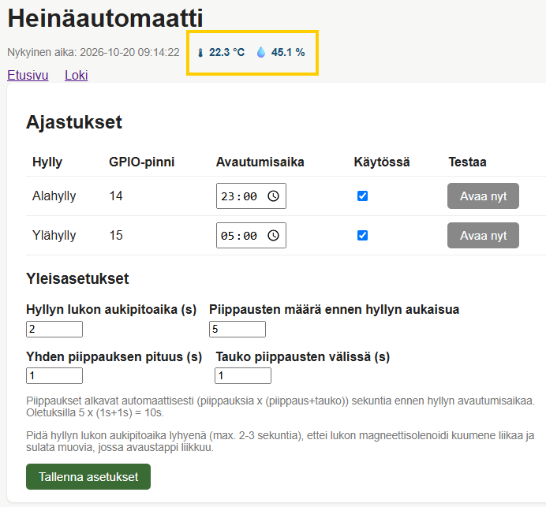

# DHT20-lämpötila/kosteus-anturi — asennusohje

Tämä uudempi versio heinäautomaatin ohjauksesta tukee optionaalista DHT20 (AHT20) -anturia, joka näyttää
tallin lämpötilan ja kosteuden web-hallintasivun yläreunassa.

 <br />

*Lämpötila ja kosteus ohjausnäkymässä*

Anturi on optionaalinen — jos se puuttuu tai ei ole kytketty,
heinäautomaatti toimii normaalisti ilman anturitietoja.

Kopioi uudempi skripti vanhan tilalle. Kannattaa ensin varmuuden vuoksi tehdä vanhasta varmuuskopio, jos jotain menee pieleen.

```bash
cd heinat
mv heina_automaatti.py heina_automaatti-old.py
git fetch
git checkout HEAD kehitys/
mv kehitys/heina_automaatti-with-dht20.py heina_automaatti.py
```

Jos git ei ole käytössä, kopioi kansion **kehitys** sisältä ao. päivitetty pääskripti.

---

## Laitteisto

- DHT20-anturi (I2C-liitäntä)
- 4 johtoa kytkentää varten

Anturi käyttää edellisen ohjeen pinnejä (GPIO 2 ja GPIO 3), koska juuri näissä pinneissä sijaitsee anturin tarvitsemat I2C-pinnit (SDA ja SCL).
Joudut siis siirtämään näissä olevat kaapelit jonnekin. Hyvä vaihtoehto on esim. [GPIO 14 ja GPIO 15], [GPIO 24 ja GPIO 24 ] tai pinnit [GPIO 20 ja GPIO 21]. Periaatteessa hyvin helppo homma. 

<a href="https://pinout.xyz/" target="_blank">Raspberry Pi pinnit</a>

Itse tilasin anturit Amazonista.
<a href="https://www.amazon.de/-/en/dp/B0DSJ5MG4T" target="_blank">DHT20 Integrated Digital Temperature and Humidity Sensor</a>

---

## Kytkentä

| DHT20-pinni | Raspberry Pi -pinni | Huomio |
|---|---|---|
| VCC | Fyysinen pinni 2 tai 4 | **5V — ei 3.3V!** |
| GND | Fyysinen pinni 6 (tai mikä tahansa GND) | Maa |
| SDA | Fyysinen pinni 3 (GPIO2) | I2C data |
| SCL | Fyysinen pinni 5 (GPIO3) | I2C kello |

> **Tärkeää:** DHT20 vaatii 5V käyttöjännitteen. 3.3V ei riitä luotettavaan
> toimintaan vaikka se on teknisesti anturin jännitealueella.
> I2C-datalinjat (SDA/SCL) toimivat silti 3.3V-tasolla — RPi 3B sietää tämän.

---

## I2C:n käyttöönotto Raspberry Pi:ssä

```bash
sudo raspi-config
```

Valitse: **Interface Options → I2C → Enable**

Käynnistä uudelleen:

```bash
sudo reboot
```

---

## Anturin kytkennän tarkistus

Asenna i2c-tools jos ei ole jo asennettu:

```bash
sudo apt install i2c-tools -y
```

Tarkista näkyykö anturi I2C-väylässä:

```bash
sudo i2cdetect -y 1
```

DHT20:n pitäisi näkyä osoitteessa `0x38`:

```
     0  1  2  3  4  5  6  7  8  9  a  b  c  d  e  f
00:                         -- -- -- -- -- -- -- --
...
30: -- -- -- -- -- -- -- -- 38 -- -- -- -- -- -- --
...
```

Jos `38` ei näy, tarkista kytkentä ja että VCC on kytketty 5V-pinniin.

---

## Python-kirjastojen asennus (RPi 3B)

RPi 3B:llä asennus vaatii erityiskohtelua — **järjestys on tärkeä**.

### 1. Aktivoi virtuaaliympäristö

```bash
source /home/pi/heina/.venv/bin/activate
```

### 2. Asenna käännöstyökalut

```bash
sudo apt install swig python3-dev -y
```

### 3. Asenna lgpio lähdekoodista

Tämä vaihe on kriittinen Pi 3B:llä — tavallinen `pip install` epäonnistuu
ilman `swig`-työkalua:

(Testattu RPi 2B ja RPi 3B, toimivat.)

```bash
sudo apt install liblgpio-dev -y
pip install lgpio --no-binary lgpio
```


### 4. Asenna Adafruit-Blinka

```bash
pip install Adafruit-Blinka
```

### 5. Asenna anturikirjasto

```bash
pip install adafruit-circuitpython-ahtx0
```

---

## Toiminnan testaus

```bash
python3 -c "
import board
import adafruit_ahtx0
i2c = board.I2C()
sensor = adafruit_ahtx0.AHTx0(i2c)
print(f'Lämpötila: {sensor.temperature:.1f} C')
print(f'Kosteus: {sensor.relative_humidity:.1f} %')
"
```

Tulosteen pitäisi näyttää esim:

```
Lämpötila: 21.3 C
Kosteus: 65.2 %
```

---

## Heinäautomaatti-palvelun uudelleenkäynnistys

```bash
sudo systemctl restart heina-automaatti.service
```

Avaa selaimella `http://192.168.50.1:8080/` — lämpötila ja kosteus
näkyvät ajan vieressä sivun yläreunassa:

```
Nykyinen aika: 2026-10-20 08:35:00  🌡 22.3 °C   💧 45.2 %
```

---

## Vianmääritys

**Anturi ei näy i2cdetect-komennossa:**
- Tarkista että VCC on kytketty 5V-pinniin (ei 3.3V)
- Tarkista SDA/SCL-johdot
- Varmista että I2C on käytössä (`sudo raspi-config`)

**ModuleNotFoundError: No module named 'board':**
- Asenna uudelleen: `pip install Adafruit-Blinka`

**ModuleNotFoundError: No module named 'adafruit_ahtx0':**
- Asenna uudelleen: `pip install adafruit-circuitpython-ahtx0`

**lgpio käännösvirhe (error: command 'swig' failed):**
- Asenna swig: `sudo apt install swig python3-dev -y`
- Asenna lgpio uudelleen: `pip install lgpio --no-binary lgpio`

**Web-sivulla ei näy lämpötilaa vaikka testaus toimii:**
- Varmista että virtuaaliympäristö on sama jota palvelu käyttää
- Tarkista palvelun loki: `journalctl -u heina-automaatti.service -n 20`
--- 
[← Takaisin](../README.md)